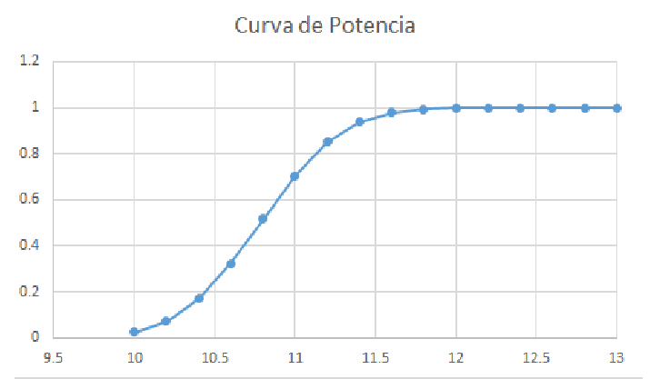
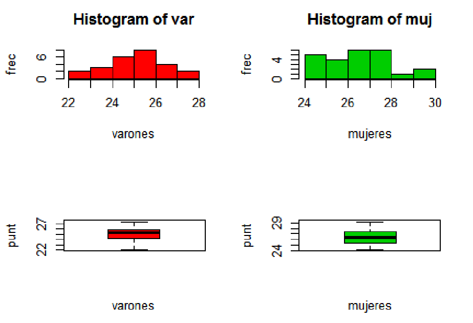
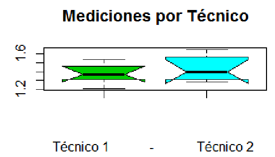

# Unidad 5 — Ejercicios resueltos

Ejercicios de la **Práctica 5 de la Guía de TP** (Test de Hipótesis).

Cada ejercicio tiene un botón **Solución**. Al abrirlo aparece la respuesta y, arriba de ella, un segundo botón **Solución paso a paso** con el desarrollo completo.

Notación: Φ(z) = P(Z < z) para Z ~ N(0; 1). $z_{q}$, $t_{n-1;\,q}$ y $\chi^2_{n-1;\,q}$ son los valores con probabilidad **acumulada q a la izquierda**. RC = región crítica (de rechazo). Los tests se resuelven con los pasos del apunte: 1) hipótesis, 2) α, 3) estadístico de prueba, 4) valor observado, 5) decisión.

> **Referencias:** *(opcional)* = la cátedra indica que no es necesario resolverlo · (T) = ejercicio teórico · (\*) = requiere aplicación informática o de celular.

---

### 1) Planteo de hipótesis

Dados los siguientes pares de aseveraciones, indicar cuál/es no cumple/n con las reglas para establecer hipótesis acerca del valor de la media poblacional μ en una prueba basada en una muestra aleatoria $\{X_1, X_2, \dots, X_n\}$. Justificar la respuesta.

- a) H₀: μ = 100 vs. H₁: μ = 200
- b) H₀: μ = 100 vs. H₁: μ < 100
- c) H₀: μ = 100 vs. H₁: μ ≠ 100
- d) H₀: μ < 100 vs. H₁: μ ≥ 100
- e) H₀: μ ≤ 100 vs. H₁: μ > 100
- f) H₀: μ ≠ 100 vs. H₁: μ = 100
- g) H₀: x̄ = 100 vs. H₁: x̄ > 100

Asociar los siguientes enunciados con las hipótesis que les correspondan.

- a) Para determinar si las soldaduras efectuadas en tubos de una planta de energía nuclear cumplen con las especificaciones, se selecciona una muestra al azar de soldaduras y se realizan pruebas en cada soldadura de la muestra. La resistencia de la soldadura se mide como la fuerza requerida para romper la soldadura. Supongamos que en las especificaciones se establece que la resistencia media de soldaduras debe rebasar 100 lb/pulg².
- b) Interesa controlar si una balanza está correctamente calibrada; para ello se pesará una pesa patrón de 100 kg, veinte veces.
- c) Se conduce una investigación para estudiar si el nivel de ventas promedio de una sucursal por día es inferior a 100 unidades.
- d) ¿Qué significaría el error de tipo I en (a)?
- e) ¿Qué implicaría el error de tipo II en (b)?

<details>
<summary><b>Solución</b></summary>

<details>
<summary>Solución paso a paso</summary>

💡 **Qué es un test de hipótesis.** Es un método para contestar una pregunta de **sí o no** sobre la población ("¿la media supera 100?") usando una muestra, y controlando la probabilidad de equivocarse.

Funciona como un **juicio**:
- **H₀ (hipótesis nula):** lo que se da por cierto mientras no haya pruebas en contra, como "inocente hasta que se demuestre lo contrario".
- **H₁ (hipótesis alternativa):** lo que **se quiere demostrar**, como "culpable".
- Si la muestra es contundente, **se rechaza H₀**: hay evidencia a favor de H₁. Si no, **no se rechaza**, pero eso no prueba que H₀ sea cierta ("no culpable" no es lo mismo que "inocente").

💡 **Reglas para escribir las hipótesis** (❌, hay que saberlas):
1. Hablan de un **parámetro** de la población (μ), nunca de $\bar x$. El promedio de la muestra ya se conoce: no hay nada que probar.
2. **H₀ lleva la igualdad** (=, ≤ o ≥), porque necesita un valor concreto para hacer cuentas.
3. **H₁ es una desigualdad estricta** (<, > o ≠) y es lo que se quiere probar.

**Pares que no cumplen:**
- **d)** La igualdad (≥) está en H₁: no cumple la regla 2.
- **f)** H₀ "μ ≠ 100" no fija ningún valor para hacer cuentas: no cumple.
- **g)** Habla de $\bar x$ en lugar de μ: no cumple la regla 1.
- **a)** es válido como test "simple contra simple" (dos valores puntuales), aunque es poco usual.

**Asociaciones.** La pregunta clave es **qué se quiere demostrar**, porque eso va en H₁:
- **(a) Soldaduras:** hay que demostrar que **superan** 100 (no se da por bueno sin pruebas): H₁: μ > 100, el **par (e)**.
- **(b) Balanza:** interesa un desvío **para cualquier lado**: H₁: μ ≠ 100, el **par (c)**.
- **(c) Ventas:** se quiere ver si es **inferior**: H₁: μ < 100, el **par (b)**.

💡 **Los dos errores posibles:**
- **Tipo I:** rechazar H₀ cuando es verdadera ("condenar a un inocente").
- **Tipo II:** no rechazar H₀ cuando es falsa ("absolver a un culpable").

- **(d) Tipo I en (a):** rechazar "μ ≤ 100" siendo cierta. Se concluye que las soldaduras **cumplen** (superan 100) cuando en realidad **no** cumplen. Es el error peligroso.
- **(e) Tipo II en (b):** no rechazar "μ = 100" siendo falsa. La balanza **está descalibrada** y el test **no lo detecta**.

</details>

**Respuesta:**

- (d), (f) y (g) no cumplen
- a) ↔ (e) · b) ↔ (c) · c) ↔ (b)
- d) Decir que cumple la especificación cuando no es así
- e) No detectar que la balanza está descalibrada

</details>

---

### 2) Regiones de rechazo

El estadístico de contraste de un ensayo de hipótesis, Z, tiene distribución Normal estándar. Indicar para cada una de las regiones de rechazo las hipótesis correspondientes y el nivel de significación considerado:

- a) {Z > 2,33}
- b) {Z < −2,58}
- c) {Z < −1,96 ∨ Z > 1,96}

<details>
<summary><b>Solución</b></summary>

<details>
<summary>Solución paso a paso</summary>

💡 **Estadístico de contraste Z.** Para decidir, se resume la muestra en un número: cuántos desvíos se apartó lo observado de lo que dice H₀. Si H₀ es cierta, ese número es una Normal estándar N(0;1).

💡 **Región de rechazo (o crítica, RC):** los valores de Z tan extremos que llevan a rechazar H₀. Está **del lado de H₁**:
- si H₁ es ">", valores grandes, a la derecha;
- si H₁ es "<", valores chicos, a la izquierda;
- si H₁ es "≠", los dos extremos.

💡 **Nivel de significación α:** la probabilidad de caer en la RC **siendo H₀ cierta**, es decir, de cometer el error tipo I. Se calcula con la N(0;1).

**a)** RC a la derecha, así que H₁: μ > μ₀ (unilateral derecho).
```
X~N(μ;σ)   μ=0   σ=1   P(X>x)   x=2.33   → 0.00990
```
**α ≈ 0,01.**

**b)** RC a la izquierda, así que H₁: μ < μ₀ (unilateral izquierdo).
```
X~N(μ;σ)   μ=0   σ=1   P(X<x)   x=−2.58   → 0.00494
```
**α ≈ 0,005.**

**c)** RC en las dos colas, así que H₁: μ ≠ μ₀ (bilateral). Se suman las dos colas, que por simetría son iguales:
```
X~N(μ;σ)   μ=0   σ=1   P(X>x)   x=1.96   → 0.025
```
**α = 2·0,025 = 0,05.**

(En la guía figura "{Z < 1,96 ∨ Z > −1,96}". Es una errata: así escrita, la región sería toda la recta.)

</details>

**Respuesta:**

- a) α = 0,01; H₀: μ = μ₀ vs. H₁: μ > μ₀
- b) α = 0,005; H₀: μ = μ₀ vs. H₁: μ < μ₀
- c) α = 0,05; H₀: μ = μ₀ vs. H₁: μ ≠ μ₀

</details>

---

### 3) Valor p con Z

Para cada uno de los siguientes pares de hipótesis, considerando una prueba cuyo estadístico de contraste tenga distribución normal estándar, indicar el valor p de la prueba para los valores observados en cada caso.

- a) H₀: μ = 10 vs. H₁: μ > 10; $Z_{obs}$ = 2,5
- b) H₀: μ = 12 vs. H₁: μ < 12; $Z_{obs}$ = −1,2
- c) H₀: μ = 7 vs. H₁: μ ≠ 7; $Z_{obs}$ = 2,8

¿En qué casos rechazaría la hipótesis nula con un nivel de significación del 5 %?

<details>
<summary><b>Solución</b></summary>

<details>
<summary>Solución paso a paso</summary>

💡 **Valor p** (❌, concepto). Es la pregunta "si H₀ fuera cierta, ¿qué tan raro sería lo que observé?". Formalmente: la probabilidad, suponiendo H₀ cierta, de obtener un estadístico **tan extremo o más** que el observado, **hacia el lado de H₁**.
- H₁ ">": la cola derecha de $z_{obs}$.
- H₁ "<": la cola izquierda.
- H₁ "≠": la cola del lado donde cayó, **multiplicada por 2**. En un bilateral, un resultado igual de extremo del otro lado también cuenta.

💡 **Regla de decisión:** **se rechaza H₀ si p < α**. Un p chico significa que, si H₀ fuera cierta, lo observado sería muy raro, así que se desconfía de H₀.

**a)** H₁ ">", cola derecha:
```
X~N(μ;σ)   μ=0   σ=1   P(X>x)   x=2.5   → 0.00621
```
p = 0,0062 < 0,05: **se rechaza**.

**b)** H₁ "<", cola izquierda:
```
X~N(μ;σ)   μ=0   σ=1   P(X<x)   x=−1.2   → 0.11507
```
p = 0,1151 > 0,05: **no se rechaza**. −1,2 no es raro para una N(0;1).

**c)** H₁ "≠". $z_{obs}$ cayó a la derecha, así que se toma esa cola y se duplica:
```
X~N(μ;σ)   μ=0   σ=1   P(X>x)   x=2.8   → 0.00256
```
p = 2·0,00256 = 0,0051 < 0,05: **se rechaza**.

**Al 5 % se rechaza en a) y en c).**

</details>

**Respuesta:**

- a) p = 0,00621 ⇒ se rechaza H₀
- b) p = 0,1151 ⇒ no se rechaza H₀
- c) p = 0,00512 ⇒ se rechaza H₀

</details>

---

### 4) Valor p con t (\*)

Dado el valor observado para una prueba basada en un estadístico t y sus grados de libertad (gl), aproximar el p valor y la decisión de una prueba con nivel de significación α = 0,05:

- a) unilateral derecha, con gl = 8, $t_{obs}$ = 2,84
- b) unilateral izquierda, con gl = 10, $t_{obs}$ = −2,5
- c) bilateral, con gl = 15, $t_{obs}$ = 1,95

¿En alguno de los casos le parece que cambiaría la decisión si se considerara un nivel de significación α = 0,01?

<details>
<summary><b>Solución</b></summary>

<details>
<summary>Solución paso a paso</summary>

💡 **Estadístico t.** Cuando no se conoce el desvío de la población y se usa el de la muestra (S), el estadístico ya no es una N(0;1), sino una **t de Student**: una campana con colas más gordas. Su parámetro son los **grados de libertad** (gl). La forma general está en 📄 H2: $\frac{\bar X - \mu}{S/\sqrt n} = t_{n-1}$.

💡 **Valor p** (❌): la probabilidad, si H₀ fuera cierta, de algo tan extremo o más que lo observado, del lado de H₁. En un bilateral se duplica la cola. **Se rechaza si p < α.**

Con tabla solo se puede acotar el p; por eso el (\*): con la app sale exacto.

**a)** Unilateral derecha, cola derecha:
```
X~t(ν)   ν=8    P(X>x)   x=2.84   → 0.01091
```
p = 0,0109 < 0,05: **se rechaza**.

**b)** Unilateral izquierda, cola izquierda:
```
X~t(ν)   ν=10   P(X<x)   x=−2.5   → 0.01572
```
p = 0,0157 < 0,05: **se rechaza**.

**c)** Bilateral, así que se duplica la cola:
```
X~t(ν)   ν=15   P(X>x)   x=1.95   → 0.03506
```
p = 2·0,03506 = 0,0701 > 0,05: **no se rechaza**. Si fuera unilateral (p = 0,035), sí se rechazaría: el tipo de test importa.

**Con α = 0,01:**
- a) 0,0109 > 0,01: deja de rechazarse.
- b) 0,0157 > 0,01: deja de rechazarse.
- c) sigue sin rechazarse.

**Sí cambia en a) y b).** La respuesta "No" de la guía no coincide con las cuentas.

</details>

**Respuesta:**

- a) p = 0,0109 ⇒ se rechaza
- b) p = 0,0157 ⇒ se rechaza
- c) p = 0,0701 ⇒ no se rechaza
- Con α = 0,01, a) y b) pasarían a no rechazarse

</details>

---

### 5) Test con una sola observación exponencial

Se dispone de una muestra de tamaño 1 para decidir entre dos hipótesis sobre la media μ de una distribución Exponencial. La hipótesis H afirma que μ ≤ 2 y la hipótesis K afirma que μ > 2.

- a) Diseñar una regla de decisión que cumpla la condición de que la máxima probabilidad de equivocarse al rechazar la hipótesis H cuando H es verdadera sea 0,1.
- b) Calcular la probabilidad de decidir en forma errónea cuando el verdadero valor de la media es μ = 2,1.

<details>
<summary><b>Solución</b></summary>

<details>
<summary>Solución paso a paso</summary>

Este ejercicio muestra que un test **no siempre es con Z o t**: la idea sirve con cualquier distribución.

**Traducción.** H (μ ≤ 2) hace de **H₀**, y K (μ > 2) de **H₁**. "La probabilidad de equivocarse al rechazar H cuando H es verdadera" es el **error tipo I**, cuya probabilidad es **α = 0,1** (el nivel de significación).

**Lo que se usa de la exponencial** (📄 H1): $E(X) = \frac1\lambda$, así que con media μ, λ = 1/μ. Es lo único que hace falta, porque las cuentas las hace la app.

**a) Diseñar la regla.** Antes de cargar nada en la app hay que tomar dos decisiones:
1. **¿De qué lado se rechaza?** Si la media es más grande, los valores tienden a ser más grandes. Una observación **grande** es evidencia de μ > 2, así que se rechaza H si X > c. 💡 Eso es la **región crítica** (de rechazo). Por eso en la app se usa el área a la **derecha**, P(X>x).
2. **¿Con qué μ se calcula?** H no es un solo valor, sino "μ ≤ 2". Se usa el **borde**, μ = 2: es el caso de H que más se parece a K, y por eso el de mayor probabilidad de error. Con μ = 2, λ = 1/2 = 0,5.

✍️ Se busca el c que deja 0,1 a la derecha. Es un cuantil, y la app lo da directo:

```
X~Exp(λ)   λ=0.5   P(X>x)=0.1   → x=4.605
```
(Si la app pide la media en lugar de la tasa, cargá 2.)

**Regla:** se rechaza H (se decide K) si la observación supera 4,6.

**b)** Con μ = 2,1 la verdadera es **K**, así que el error posible es **no rechazar H**. 💡 Es el **error tipo II**, y su probabilidad se llama **β**. No se rechaza H cuando X ≤ 4,605, y ahora esa probabilidad se calcula con la media verdadera, 2,1 (λ = 1/2,1 = 0,47619):

```
X~Exp(λ)   λ=0.47619   P(X<x)   x=4.605   → 0.8884
```
Casi el 89 % de las veces **no** se detecta que μ > 2. Con 2,1 tan cerca de 2 y **una sola** observación, es casi imposible notar la diferencia.

</details>

**Respuesta:**

- a) Se rechaza H si $x_{obs}$ > 4,6
- b) 0,8884

</details>

---

### 6) Nuevo sistema de producción

Una empresa estudia introducir un nuevo sistema de producción para mejorar su productividad media, establecida actualmente en 42 unidades por persona y por día. Se estima que el cambio no será rentable si no consigue elevar dicho número por encima de 45 u. Realizada una prueba con la nueva tecnología, aplicada a 35 personas, se obtuvo una producción media de 46,5 y no se observó ningún cambio apreciable en la dispersión, que estaba establecida en σ = 3 u por día. Considerando esta información y utilizando un nivel de significación del 1 %, ¿se debería efectuar el cambio tecnológico?

<details>
<summary><b>Solución</b></summary>

<details>
<summary>Solución paso a paso</summary>

**La pregunta de fondo:** la muestra dio 46,5, más que 45. ¿Alcanza para afirmar que la media de **toda** la producción supera 45, o pudo salir así por casualidad?

⚠️ El 42 es un distractor. El valor que importa es **45**, porque el cambio solo conviene si se supera 45.

💡 **Los 5 pasos de un test** (como en un juicio, H₀ es "inocente" hasta que la evidencia diga lo contrario):

**1) Hipótesis.** Lo que se quiere demostrar ("supera 45") va en H₁. H₀ lleva la igualdad:

$`\displaystyle H_0: \mu \le 45 \qquad H_1: \mu > 45`$

**2) Nivel de significación:** α = 0,01, el riesgo aceptado de rechazar H₀ siendo cierta.

**3) Estadístico.** 💡 Se mide a cuántos desvíos de 45 cayó el promedio. El promedio varía con desvío $\frac{\sigma}{\sqrt n}$ (📄 H2, $`\bar X \sim N(\mu;\ \sigma/\sqrt n)`$), y se estandariza (📄 H1, $`\frac{X - \mu}{\sigma} = Z`$):

$$Z = \frac{\bar X - 45}{\sigma/\sqrt n} \sim N(0;1) \text{ si } \mu = 45$$

Se usa Z porque σ = 3 es **conocido** (la dispersión "establecida") y n = 35 ≥ 30.

**4) Valor observado:**

$$\frac{\sigma}{\sqrt n} = \frac{3}{\sqrt{35}} = 0{,}507 \qquad z_{obs} = \frac{46{,}5 - 45}{0{,}507} = 2{,}96$$

**5) Decisión.** 💡 La **región crítica** está del lado de H₁ (a la derecha) y deja α = 0,01:
```
X~N(μ;σ)   μ=0   σ=1   P(X<x)=0.99   → x=2.32635
```
RC = {Z > 2,326}. Como 2,96 > 2,326, **se rechaza H₀**.

💡 Con el **valor p** (la probabilidad, si μ = 45, de un resultado tan alto o más): se rechaza si p < α.
```
X~N(μ;σ)   μ=0   σ=1   P(X>x)   x=2.96   → 0.00155
```
p = 0,0015 < 0,01 ✓.

**En unidades** (la RC en la escala de $`\bar X`$): $45 + 2{,}326\cdot0{,}507 = 46{,}18$. El promedio 46,5 supera 46,18 ✓.

**Conclusión:** hay evidencia al 1 % de que la productividad supera las 45 unidades. **Conviene hacer el cambio.**

</details>

**Respuesta:** Se rechaza H₀ ($`z_{obs}`$ = 2,96 > 2,33): hay evidencia al 1 % de que la productividad supera 45 ⇒ conviene implementar el cambio.

</details>

---

### 7) Calibración de un fotómetro

Se desea calibrar un fotómetro para medir la proporción de monóxido de carbono (CO) de un gas. Se toman 25 mediciones de una muestra patrón con 60 ppm de proporción de CO, sabiendo que los errores de medición tienen distribución Normal con dispersión σ = 0,5 ppm. Designando con μ al verdadero valor medio de la calibración del fotómetro:

- a) ¿Qué hipótesis probaría?
- b) Si se rechaza la hipótesis de nulidad para valores de x̄ superiores a 60,196 ppm o inferiores a 59,804 ppm, ¿cuál es la probabilidad de que la recalibración se realice sin ser necesaria?
- c) ¿Cuál es la probabilidad de no recalibrar si el fotómetro mide 60,3 ppm?

<details>
<summary><b>Solución</b></summary>

<details>
<summary>Solución paso a paso</summary>

**a)** 💡 En un test, H₀ es lo que se da por cierto salvo evidencia, y lleva la igualdad. H₁ es lo que se quiere detectar. El fotómetro está bien si en promedio marca 60, y un error **para cualquier lado** es un problema:

$`\displaystyle H_0: \mu = 60 \qquad H_1: \mu \ne 60 \quad \text{(bilateral)}`$

**Dato común.** El promedio de 25 mediciones varía con desvío $\frac{\sigma}{\sqrt n} = \frac{0{,}5}{5} = 0{,}1$ (📄 H2, $`\bar X \sim N(\mu;\ \sigma/\sqrt n)`$).

**b)** "Recalibrar sin ser necesario" es rechazar H₀ cuando es cierta. 💡 Es el **error tipo I**, y su probabilidad es **α** (el nivel de significación). Se calcula **suponiendo μ = 60**: es la probabilidad de caer en la región de rechazo, que son las dos colas.

$$\alpha = P(\bar X > 60{,}196) + P(\bar X < 59{,}804), \quad \bar X \sim N(60;\ 0{,}1)$$

```
X~N(μ;σ)   μ=60   σ=0.1   P(X>x)   x=60.196   → 0.025
X~N(μ;σ)   μ=60   σ=0.1   P(X<x)   x=59.804   → 0.025
```
**α = 0,05.** Las fronteras son 60 ± 1,96·0,1.

**c)** "No recalibrar si el fotómetro mide 60,3" es no rechazar H₀ cuando es falsa. 💡 Es el **error tipo II**, y su probabilidad es **β**. Se calcula **con el valor verdadero**, μ = 60,3: es la probabilidad de caer **dentro** de la zona de no rechazo.

$$\beta = P(59{,}804 < \bar X < 60{,}196), \quad \bar X \sim N(60{,}3;\ 0{,}1)$$

```
X~N(μ;σ)   μ=60.3   σ=0.1   P(X<x)   x=60.196   → 0.14917
X~N(μ;σ)   μ=60.3   σ=0.1   P(X<x)   x=59.804   → 0.0000004
```
**β = 0,1492.** Si el fotómetro está corrido 0,3 ppm, un 15 % de las veces no se detecta.

**Receta para β** (❌): la zona de rechazo se arma con el valor de H₀, y la probabilidad se calcula con el valor verdadero.

</details>

**Respuesta:**

- a) H₀: μ = 60 vs. H₁: μ ≠ 60
- b) α = 0,05
- c) 0,1492

</details>

---

### 8) Rendimiento del auto A

Un fabricante sostiene que el modelo de auto A tiene un rendimiento promedio menor a 13 kilómetros por litro de nafta. Se selecciona una muestra de 9 de estos vehículos, y cada uno es conducido con un litro de nafta en las mismas condiciones. La muestra proporciona una media de 12,34 km/l. Se sabe que la distribución de la cantidad de kilómetros recorridos por litro de nafta es Normal con un desvío estándar de 1,26 km/l.

- a) Plantear las hipótesis a contrastar, el estadístico del test junto con su distribución y la decisión tomada a nivel 0,05.
- b) ¿El test elegido es de nivel exacto o aproximado? Justificar.
- c) ¿Cuál es la probabilidad de no decidir que se cumple la hipótesis del fabricante, cuando el verdadero rendimiento medio del modelo de auto A es de 12 km/l?

<details>
<summary><b>Solución</b></summary>

<details>
<summary>Solución paso a paso</summary>

**a)** 💡 **Hipótesis.** Lo que se quiere demostrar va en H₁; H₀ lleva la igualdad. El fabricante dice "menor a 13" (desigualdad estricta), así que va en H₁:

$`\displaystyle H_0: \mu \ge 13 \qquad H_1: \mu < 13`$

💡 **Estadístico.** σ = 1,26 es conocido y la población es Normal, así que el promedio es Normal con desvío $\frac{\sigma}{\sqrt n} = \frac{1{,}26}{3} = 0{,}42$ (📄 H2). **Suponiendo H₀ cierta** (μ = 13):

$$\bar X \sim N(13;\ 0{,}42) \qquad \text{o, estandarizando: } Z = \frac{\bar X - 13}{0{,}42} \sim N(0;1)$$

💡 **Región crítica:** se rechaza con promedios **chicos** (lado de H₁), dejando α = 0,05 a la izquierda. En km/l:
```
X~N(μ;σ)   μ=13   σ=0.42   P(X<x)=0.05   → x=12.309
```
RC = {$`\bar X`$ < 12,309}. El observado 12,34 **no** es menor que 12,309, así que **no se rechaza H₀**.

Con Z: $z_{obs} = \frac{12{,}34 - 13}{0{,}42} = -1{,}571$, que es mayor que −1,645. Valor p:
```
X~N(μ;σ)   μ=0   σ=1   P(X<x)   x=−1.571   → 0.0580
```
p = 0,058 > 0,05.

**Conclusión:** al 5 % no hay evidencia suficiente de que el rendimiento sea menor a 13. Queda muy justo: al 10 % sí se rechazaría.

**b) Exacto.** La población es Normal y σ es conocido, así que $\bar X$ es **exactamente** Normal y α es exactamente 0,05. Sería "aproximado" (asintótico) si se usara el TCL porque la población no fuera Normal.

**c)** "No decidir que se cumple lo del fabricante" es **no rechazar H₀**. Si en verdad μ = 12, H₀ es falsa, así que es un 💡 **error tipo II**, de probabilidad **β**.

**Receta** (❌): la frontera es la de la RC (calculada con 13), y la probabilidad se calcula con el μ verdadero (12):

$$\beta = P(\bar X > 12{,}309) \text{ con } \bar X \sim N(12;\ 0{,}42)$$

```
X~N(μ;σ)   μ=12   σ=0.42   P(X>x)   x=12.309   → 0.2308
```
Aunque el fabricante tenga razón, hay un 23 % de chances de no confirmarlo: con n = 9 el test tiene poca **potencia** (1 − β = 0,77).

</details>

**Respuesta:**

- a) H₀: μ ≥ 13 vs. H₁: μ < 13; $\bar X \sim N(13; 0{,}42)$; no se rechaza H₀ al 5 %
- b) Exacto, pues se conoce la distribución exacta del estadístico
- c) 0,231

</details>

---

### 9) Curva de potencia (\*)

(\*) La siguiente gráfica corresponde a la curva de potencia de una prueba para la media de una población normal, conocida la varianza σ² = 4, basada en una muestra de tamaño n = 25 (la potencia vale α en μ = 10 y crece hacia 1 para μ > 10).

<p align="center"></p>

- a) Indicar qué hipótesis se están testeando.
- b) Sabiendo que $\beta_{\mu=11}$ = 0,2946, ¿cuál es el nivel de significación de la prueba?
- c) Hallar la probabilidad del error de tipo II para μ = 11,2, μ = 11,5 y μ = 12.

<details>
<summary><b>Solución</b></summary>

<details>
<summary>Solución paso a paso</summary>

💡 **Potencia de un test:** la probabilidad de **rechazar H₀**, calculada para cada posible valor verdadero de μ.
- Cuando μ es el de H₀, rechazar es un error (tipo I): la potencia vale **α**.
- Cuando μ es otro valor (H₀ falsa), rechazar es acertar: la potencia vale **1 − β**, donde β es la probabilidad del error tipo II (no detectar).

La **curva de potencia** grafica eso para cada μ. Sube cuanto más lejos está μ del valor de H₀, hacia el lado de H₁.

**a)** La curva vale α en 10 y crece solo hacia la derecha: el test "detecta" valores **mayores** a 10.

$`\displaystyle H_0: \mu = 10 \qquad H_1: \mu > 10`$

**Dato común.** El promedio varía con desvío $\frac{\sigma}{\sqrt n} = \frac{2}{5} = 0{,}4$ (📄 H2, $\bar X \sim N(\mu;\ \sigma/\sqrt n)$; σ = √4 = 2). Se rechaza si $\bar X$ > c, con c desconocido.

**b) La idea:** con el dato de β se encuentra la frontera c, y con c se calcula α.

✍️ **Paso 1.** β(11) es no rechazar cuando μ = 11, es decir $P(\bar X < c) = 0{,}2946$ con $\bar X \sim N(11;\ 0{,}4)$. La app da c directamente:
```
X~N(μ;σ)   μ=11   σ=0.4   P(X<x)=0.2946   → x=10.784
```

✍️ **Paso 2.** α es rechazar cuando μ = 10:
```
X~N(μ;σ)   μ=10   σ=0.4   P(X>x)   x=10.784   → 0.0250
```
**α = 0,025.** Control: (10,784 − 10)/0,4 = 1,96, el z del 2,5 % ✓.

**c)** $\beta_\mu = P(\bar X < 10{,}784)$ con $\bar X \sim N(\mu;\ 0{,}4)$, para cada μ:
```
X~N(μ;σ)   μ=11.2   σ=0.4   P(X<x)   x=10.784   → 0.1492
X~N(μ;σ)   μ=11.5   σ=0.4   P(X<x)   x=10.784   → 0.0367
X~N(μ;σ)   μ=12     σ=0.4   P(X<x)   x=10.784   → 0.0012
```
Cuanto más lejos de 10 está el μ verdadero, más chico es β: más fácil es detectarlo.

</details>

**Respuesta:**

- a) H₀: μ = 10 vs. H₁: μ > 10
- b) α = 0,025
- c) $\beta_{11{,}2}$ = 0,1492; $\beta_{11{,}5}$ ≈ 0,03; $\beta_{12}$ = 0,0012

</details>

---

### 10) Compresión del cemento: tamaño de muestra

El coeficiente de compresión del cemento curado sigue una distribución Normal con una media de 50 kg/cm² (en cientos). Utilizar un cemento de menor coeficiente promedio podría ocasionar problemas en la construcción, por lo que se requiere tener una probabilidad de 0,95 de descartar las partidas si el coeficiente de compresión promedio proviniera de una población con coeficiente de compresión promedio de 47 kg/cm², y una probabilidad de 0,01 de rechazar las partidas que cumplan con la especificación. Supongamos que el desvío de la población es de 5 kg/cm².

- a) Plantear un test adecuado. Justificar las hipótesis elegidas.
- b) Calcular el tamaño de la muestra necesario para que se cumplan las condiciones requeridas y establecer la zona de rechazo y la regla de decisión.

<details>
<summary><b>Solución</b></summary>

<details>
<summary>Solución paso a paso</summary>

**a)** 💡 En un test, H₁ es lo que se quiere detectar, y H₀ lleva la igualdad. El peligro es un coeficiente **menor** al especificado:

$`\displaystyle H_0: \mu = 50 \qquad H_1: \mu < 50`$

"Rechazar H₀" significa **descartar la partida**. Se rechaza con promedios chicos: $\bar X < x_c$.

**Traducción de los datos a errores:**
- "Probabilidad 0,01 de rechazar partidas que cumplen" es rechazar H₀ siendo cierta: el 💡 **error tipo I**, **α = 0,01**.
- "Probabilidad 0,95 de descartar si μ = 47" es la **potencia** en 47. Entonces la probabilidad de **no** descartar (💡 **error tipo II**) es **β = 0,05**.

**b) La idea** (❌, deducción): hay dos incógnitas, n y la frontera $x_c$. Cada error da una ecuación para $x_c$, y se igualan. El promedio es Normal con desvío $\frac{5}{\sqrt n}$ (📄 H2).

**Ecuación I (α, con μ = 50):** $P(\bar X < x_c) = 0{,}01$. Estandarizando (📄 H1):
```
X~N(μ;σ)   μ=0   σ=1   P(X<x)=0.01   → x=−2.32635
```

$$x_c = 50 - 2{,}32635\cdot\frac{5}{\sqrt n}$$

**Ecuación II (β, con μ = 47):** $P(\bar X < x_c) = 0{,}95$, porque se descarta el 95 % de las veces:
```
X~N(μ;σ)   μ=0   σ=1   P(X<x)=0.95   → x=1.64485
```

$$x_c = 47 + 1{,}64485\cdot\frac{5}{\sqrt n}$$

**Igualando:**

$$50 - 47 = (2{,}32635 + 1{,}64485)\frac{5}{\sqrt n} \;\Rightarrow\; \sqrt n = \frac{3{,}9712\cdot5}{3} = 6{,}619 \;\Rightarrow\; n = 43{,}8 \;\Rightarrow\; n = 44$$

Siempre se redondea hacia arriba.

**Regla de decisión.** Con n = 44, la frontera sale de la ecuación I, para que α quede exacto:

$$x_c = 50 - 2{,}32635\cdot\frac{5}{\sqrt{44}} = 50 - 1{,}754 = 48{,}25$$

Se toman 44 probetas y **se descarta la partida si $\bar x$ < 48,25**. (El repo da 48,24 con z redondeado.)

</details>

**Respuesta:**

- a) H₀: μ = 50 vs. H₁: μ < 50; se rechaza H₀ si $\bar x < 50 - 2{,}33\frac{5}{\sqrt n}$
- b) n = 44; se rechazan las partidas con $\bar x$ < 48,24

</details>

---

### 11) Altura de la espuma del shampoo

Una compañía de productos para el consumidor está desarrollando un nuevo shampoo y está interesada en la altura de la espuma (en mm). La altura de la espuma tiene una distribución aproximadamente Normal. La compañía quiere verificar si la altura de la espuma supera los 180 mm, y se considera una muestra de tamaño 24. Los valores observados son:

122,72 182,53 156,03 200,31 219,86 187,20 213,00 133,47 203,39 207,56 212,64 132,57 204,95 181,51 184,27 194,70 184,46 169,48 207,28 186,65 195,85 181,26 181,78 211,32

- a) Establecer las hipótesis correspondientes al test.
- b) Interpretar la salida del programa R. Concluir.

```
data: muestra
t = 0.81221, df = 23, p-value = 0.2123
alternative hypothesis: true mean is greater than 180
sample estimates:
mean of x 185.62
```

<details>
<summary><b>Solución</b></summary>

<details>
<summary>Solución paso a paso</summary>

**a)** 💡 En un test, lo que se quiere demostrar va en **H₁**, y **H₀** lleva la igualdad. Se quiere verificar que **supera** 180:

$`\displaystyle H_0: \mu \le 180 \qquad H_1: \mu > 180`$

**b)** 💡 **Test t.** No se conoce el desvío de la población: se estima con el de la muestra (S). Por eso el estadístico es una **t de Student** con n − 1 grados de libertad, en lugar de una Z. Con n = 24 hace falta que la población sea Normal, y el enunciado lo dice. 📄 H2:

$$T = \frac{\bar X - 180}{S/\sqrt n} \sim t_{23}$$

**Cómo leer la salida de R:**
- `t = 0.81221`: el estadístico observado;
- `df = 23`: los grados de libertad (n − 1);
- `alternative: greater than 180`: unilateral derecho, como en a);
- `p-value = 0.2123`: el 💡 **valor p**, la probabilidad de un resultado tan extremo o más si H₀ fuera cierta.

**Decisión:** se rechaza si p < α. 0,2123 > 0,05, así que **no se rechaza H₀**. No hay evidencia de que la altura media supere los 180 mm. Aunque $\bar x$ = 185,6 > 180, la diferencia se explica por el azar: los datos varían mucho.

**Hacerlo con las apps.** Calculadora de estadística → Estadística descriptiva con los 24 datos:
```
→ media = 185.616   desvío = 26.415   error estándar = 5.392
```

$$t_{obs} = \frac{185{,}616 - 180}{5{,}392} = 1{,}042$$

```
X~t(ν)   ν=23   P(X<x)=0.95   → x=1.71387   (valor crítico)
X~t(ν)   ν=23   P(X>x)   x=1.042   → 0.1542  (valor p)
```
1,042 < 1,714: tampoco se rechaza.

⚠️ Con estos datos sale t = 1,04, no 0,81 como en la salida de R; posiblemente R usó otros datos. La conclusión es la misma.

**Control:** Calculadora de estadística → **Prueba T una media**, con μ₀ = 180 y H₁ "mayor".

</details>

**Respuesta:**

- a) H₀: μ ≤ 180 vs. H₁: μ > 180
- b) p = 0,2123 > 0,05 ⇒ no se rechaza H₀. No hay evidencia de que la altura media supere los 180 mm

</details>

---

### 12) Índice de esfericidad *(opcional)*

La calidad de ciertas piezas de un aparato depende de su esfericidad. Para mejorar el control de calidad se determinó un nuevo método para medir el índice de esfericidad (IE) y se aplicó en 91 piezas.

| Variable | n | Media | D.E. | W\* | p (una cola) |
|---|---|---|---|---|---|
| IE | 91 | 1,45 | 0,22 | 0,93 | 0,2569 |

(Test de Shapiro-Wilks). El método de medición anterior tiene un desvío estándar de 0,32 plg. Interesa determinar si el nuevo método es más preciso, es decir, si tiene menor desvío estándar.

- a) Analizar el cumplimiento de los supuestos para realizar un test y usar un nivel de significación del 5 %.
- b) Realizar la prueba y concluir en el contexto del problema.

<details>
<summary><b>Solución</b></summary>

<details>
<summary>Solución paso a paso</summary>

**¿Qué se quiere ver?** Si el método nuevo es **más preciso**, es decir, si tiene **menor desvío** que 0,32. Es un test sobre la **varianza**.

**a) Supuestos.** 💡 Para testear una varianza se usa que, **si la población es Normal**, $\frac{(n-1)S^2}{\sigma^2} \sim \chi^2_{n-1}$ (📄 H2). La normalidad es **obligatoria**.

💡 **Test de Shapiro-Wilks:** un test cuya H₀ es "los datos vienen de una Normal". Su valor p es 0,2569 > 0,05, así que **no se rechaza la normalidad**: se puede usar la χ².

**b)** 💡 Lo que se quiere demostrar ("más preciso", menor σ) va en H₁:

$`\displaystyle H_0: \sigma^2 = 0{,}32^2 \qquad H_1: \sigma^2 < 0{,}32^2`$

**Estadístico** (📄 H2, con σ² reemplazado por el valor de H₀):

$`\displaystyle \chi^2 = \frac{(n-1)S^2}{\sigma_0^2} \sim \chi^2_{90} \qquad \chi^2_{obs} = \frac{90\cdot0{,}22^2}{0{,}32^2} = 42{,}54`$

**Región crítica.** H₁ es "<", así que se rechaza con valores **chicos** de χ², con área α = 0,05 a la izquierda:
```
X~χ²(ν)   ν=90   P(X<x)=0.05    → x=69.126
X~χ²(ν)   ν=90   P(X<x)   x=42.54   → 0.000005   (valor p)
```
42,54 < 69,13: **se rechaza H₀**. Hay evidencia de que el nuevo método es más preciso.

</details>

**Respuesta:**

- a) H₀: σ² = 0,32² vs. H₁: σ² < 0,32²; Shapiro-Wilks no rechaza la normalidad, así que vale el test χ²
- b) $\chi^2_{obs}$ = 42,539 < 69,126 ⇒ se rechaza H₀: hay evidencia de que el nuevo método es más preciso

</details>

---

### 13) Tiempo de armado según el capataz

Un capataz afirma que bajo su supervisión el armado de una pieza tiene una duración promedio inferior a 25 minutos y una dispersión de 2 minutos. El tiempo medio arrojado por una muestra de 25 obreros con este nuevo proceso resultó de 23 minutos y el desvío estándar muestral es de 3,9 minutos. Los tiempos se distribuyen en forma aproximadamente Normal.

- a) Plantear un test para decidir si la media y la variabilidad del tiempo del armado de una pieza coinciden con la afirmación del capataz.
- b) Concluir en función de los datos muestrales, considerando un nivel de significación del 5 %.

<details>
<summary><b>Solución</b></summary>

<details>
<summary>Solución paso a paso</summary>

El capataz afirma **dos cosas** (media y dispersión), así que se hacen **dos tests**.

### Test 1: la media
💡 **Hipótesis.** Lo que se quiere demostrar va en H₁. "Inferior a 25" es estricta, así que va en H₁:

$`\displaystyle H_0: \mu \ge 25 \qquad H_1: \mu < 25`$

💡 **¿Z o t?** El "2 minutos" es lo que **afirma** el capataz, no un dato confiable. Lo que se tiene es S = 3,9 de la muestra, así que σ es desconocido y se usa la **t de Student** con n − 1 = 24 grados de libertad (población aproximadamente Normal). 📄 H2:

$`\displaystyle T = \frac{\bar X - 25}{S/\sqrt n} \sim t_{24} \qquad t_{obs} = \frac{23 - 25}{3{,}9/5} = \frac{-2}{0{,}78} = -2{,}564`$

**Región crítica**, del lado de H₁ (izquierda), con α = 0,05:
```
X~t(ν)   ν=24   P(X<x)=0.05   → x=−1.71088
X~t(ν)   ν=24   P(X<x)   x=−2.564   → 0.0085   (valor p)
```
−2,564 < −1,711: **se rechaza H₀**. Hay evidencia de que el tiempo medio es menor a 25 minutos: **en esto el capataz tiene razón**.

### Test 2: la varianza
💡 Para una dispersión se usa la **χ²**. Si la población es Normal, $\frac{(n-1)S^2}{\sigma^2} \sim \chi^2_{n-1}$ (📄 H2). En el test, σ² se reemplaza por el valor de H₀.

**Hipótesis.** El capataz afirma σ = 2, es decir σ² = 4. Es una **igualdad**, y solo puede ir en H₀:

$`\displaystyle H_0: \sigma^2 = 4 \qquad H_1: \sigma^2 \ne 4`$

Ojo: ahora lo del capataz queda en H₀. Si no se rechazara, no quedaría demostrado; solo no habría evidencia en contra.

**Estadístico:**

$$\chi^2_{obs} = \frac{24\cdot3{,}9^2}{4} = \frac{24\cdot15{,}21}{4} = 91{,}26$$

**Región crítica.** Bilateral, así que α/2 = 0,025 en cada cola:
```
X~χ²(ν)   ν=24   P(X<x)=0.025   → x=12.401
X~χ²(ν)   ν=24   P(X<x)=0.975   → x=39.364
```
RC = {χ² < 12,40} ∪ {χ² > 39,36}. Como 91,26 > 39,36, **se rechaza H₀**: el desvío **no** es 2 minutos (la muestra da 3,9). **En esto el capataz no tiene razón.**

</details>

**Respuesta:**

- Media: $t_{obs}$ = −2,56 < $t_{crít}$ = −1,71 ⇒ se rechaza H₀; la afirmación sobre la media es correcta
- Varianza: $\chi^2_{obs}$ = 91,26 > 39,36 ⇒ se rechaza H₀; la afirmación sobre la dispersión no es correcta

</details>

---

### 14) Neumáticos Mirelli

El fabricante de neumáticos Mirelli sostiene que en promedio sus productos tienen una duración superior a 50.000 km antes de necesitar reemplazo. Un grupo de consumidores quiere poner a prueba dicha afirmación. Para ello seleccionan una muestra de 50 neumáticos y resulta que en promedio duraron 50.300 km, con una dispersión de 1000 km.

- a) Definir con claridad cuál sería el parámetro de interés en este problema.
- b) Establecer la hipótesis nula y la alternativa en términos de dicho parámetro.
- c) Explicar el significado de los errores de tipo I y II en el contexto de este problema.
- d) Responder si la afirmación del fabricante es aceptable con un nivel de significación del 0,01.

<details>
<summary><b>Solución</b></summary>

<details>
<summary>Solución paso a paso</summary>

**a)** 💡 Un **parámetro** es un número que describe a **toda la población** y que no se conoce. Acá es μ = la duración media de **todos** los neumáticos Mirelli. No es el 50 300 de la muestra: ese ya se conoce.

**b)** 💡 En un test, lo que se quiere demostrar va en **H₁**, y **H₀** lleva la igualdad. Lo que se pone a prueba es "duran **más** de 50 000" (desigualdad estricta):

$`\displaystyle H_0: \mu \le 50\,000 \qquad H_1: \mu > 50\,000`$

**c)** 💡 Los dos errores posibles al decidir:
- **Tipo I** (rechazar H₀ siendo cierta): concluir que duran más de 50 000 km **cuando no es así**. Los consumidores le darían la razón al fabricante sin motivo.
- **Tipo II** (no rechazar H₀ siendo falsa): **no detectar** que duran más de 50 000 cuando sí duran. Se le quitaría la razón al fabricante injustamente.

**d)** 💡 La dispersión de 1000 es **de la muestra** (S), así que el estadístico es una **t** con n − 1 = 49 grados de libertad (📄 H2, $`\frac{\bar X - \mu}{S/\sqrt n} = t_{n-1}`$):

$$t_{obs} = \frac{50\,300 - 50\,000}{1000/\sqrt{50}} = \frac{300}{141{,}42} = 2{,}121$$

**Región crítica** (derecha, α = 0,01):
```
X~t(ν)   ν=49   P(X<x)=0.99   → x=2.40489
X~t(ν)   ν=49   P(X>x)   x=2.121   → 0.0195   (valor p)
```
2,121 < 2,405 (o p = 0,0195 > 0,01): **no se rechaza H₀**. Con n ≥ 30 también vale z = 2,326, y la decisión es la misma.

**Conclusión:** al 1 % **no hay evidencia suficiente** para aceptar la afirmación del fabricante. Al 5 % sí se habría rechazado (p < 0,05): el α elegido importa.

</details>

**Respuesta:**

- a) μ: duración media real de los neumáticos Mirelli
- b) H₀: μ ≤ 50000 vs. H₁: μ > 50000
- c) Tipo I: confiar en que la duración supera 50000 km cuando no es así. Tipo II: no detectar que la supera
- d) $t_{obs}$ = 2,12 < 2,405 ⇒ no se rechaza H₀ al 1 %: no hay evidencia suficiente para la afirmación del fabricante

</details>

---

### 15) Proveedores de internet

Dos empresas distintas compiten para brindar servicio de internet en cierta región. Denotamos con p a la proporción de pobladores que prefieren a la primera de las empresas por encima de la segunda. Se toma una muestra aleatoria de 50 personas para probar la hipótesis de que la primera empresa tiene conquistada más de la mitad del mercado.

- a) Considerando que X es la cantidad de individuos encuestados que optaron por la primera empresa, ¿cuál de las siguientes regiones de rechazo le parece más adecuada? {x ≥ 32}; {x ≤ 18}; {x ≤ 15 ∨ x ≥ 45}
- b) ¿Cuál es la distribución de probabilidad de X siendo cierta H₀?
- c) ¿Qué se puede concluir, al 1 %, si 12 personas estuvieron a favor de la segunda empresa? ¿Cuál es el p valor de la prueba?
- d) ¿Cuál es la probabilidad de cometer error de tipo II si p = 0,6?

<details>
<summary><b>Solución</b></summary>

<details>
<summary>Solución paso a paso</summary>

**Test para una proporción.** Se quiere demostrar que la primera empresa tiene **más de la mitad** del mercado. 💡 Lo que se quiere demostrar va en H₁:

$`\displaystyle H_0: p = 0{,}5 \qquad H_1: p > 0{,}5`$

**a)** 💡 La **región de rechazo** está del lado de H₁. Si p > 0,5, se esperan **muchos** a favor de la primera, así que se rechaza con valores **grandes** de X: **{X ≥ 32}**.
- {X ≤ 18} serviría para H₁: p < 0,5.
- {X ≤ 15 ∨ X ≥ 45} sería bilateral, y además asimétrico.

**b)** Cada encuestado prefiere la primera (éxito) o no, independientemente, con la misma probabilidad p. X cuenta éxitos en 50 ensayos, así que es **binomial** (📄 H1). **Suponiendo H₀ cierta:**

$$X \sim Bin(50;\ 0{,}5)$$

Con eso se ve el α de la región de a): `X~Bin(n,p) n=50 p=0.5 P(X≥x) x=32 → 0.0325`.

**c)** "12 a favor de la segunda" significa x = 38 a favor de la primera, y $\hat p = 0{,}76$.

💡 **Estadístico Z para proporciones.** Por el TCL, $\hat p \sim N\left(p;\ \sqrt{\frac{p(1-p)}{n}}\right)$ (📄 H2). Se estandariza **suponiendo H₀ cierta**, así que en la raíz va **p₀ = 0,5**, no $\hat p$:

$`\displaystyle Z = \frac{\hat p - p_0}{\sqrt{p_0(1-p_0)/n}} = \frac{0{,}76 - 0{,}5}{\sqrt{0{,}25/50}} = \frac{0{,}26}{0{,}0707} = 3{,}68`$

```
X~N(μ;σ)   μ=0   σ=1   P(X<x)=0.99   → x=2.32635
X~N(μ;σ)   μ=0   σ=1   P(X>x)   x=3.68   → 0.00012   (valor p)
```
3,68 > 2,326: **se rechaza H₀** al 1 %. **Valor p ≈ 0,0001.** Con la binomial exacta: `X~Bin(n,p) n=50 p=0.5 P(X≥x) x=38 → 0.00015`.

**d)** 💡 **Error tipo II (β):** no rechazar H₀ cuando es falsa. Con la región {X ≥ 32}, no rechazar es X ≤ 31, y se calcula con el p **verdadero**, 0,6.

**Como la guía (aproximación Normal):** $E(X) = np = 30$ y $V(X) = np(1-p) = 12$ (📄 H1), así que X ≈ N(30; 3,46):

$$\beta \approx \Phi\left(\frac{32 - 30}{3{,}46}\right) = \Phi(0{,}577) = 0{,}718$$

**Exacto, con la binomial de la app:**
```
X~Bin(n,p)   n=50   p=0.6   P(X≤x)   x=31   → 0.6644
```
La diferencia es por la aproximación. Si se usa la app, aclarar que es el valor exacto.

</details>

**Respuesta:**

- a) {X ≥ 32}
- b) X ~ Bi(50; 0,5) bajo H₀: p = 0,5
- c) $z_{obs}$ ≈ 3,7; p valor < 0,001 ⇒ se rechaza H₀
- d) 0,718

</details>

---

### 16) Crema para manchas

Una empresa de cosmética afirma que una nueva crema reduce las manchas del cutis tras un uso prolongado (3 meses o más) en más de un 60 %. A fin de verificar la veracidad de esta afirmación, un centro de belleza que pretende adquirir este producto utilizará el mismo en 120 manchas de cutis de clientas elegidas al azar. Si se eliminan más de 82 manchas, tomará la decisión de adquirir el nuevo producto.

- a) Evaluar el nivel de significación utilizado.
- b) Hallar el error de tipo II que se cometería si el producto lograra limpiar el 75 % de las manchas.

<details>
<summary><b>Solución</b></summary>

<details>
<summary>Solución paso a paso</summary>

💡 **Planteo del test.** La empresa afirma que la crema elimina **más del 60 %**. Lo que se pone a prueba va en H₁:

$`\displaystyle H_0: p = 0{,}6 \qquad H_1: p > 0{,}6`$

X = manchas eliminadas de 120. Cada mancha se elimina o no, independientemente, así que X ~ Bin(120; p) (📄 H1). "Comprar" significa rechazar H₀, y la **región de rechazo** ya está dada: {X > 82}.

**a)** 💡 **Nivel de significación α:** la probabilidad de rechazar H₀ **cuando es cierta** (error tipo I). Se calcula con p = 0,6.

**Aproximación Normal (como la guía).** Con n grande la binomial se parece a una normal con la misma media y varianza (📄 H1, $`V = np(1-p)`$):

$$E(X) = 120\cdot0{,}6 = 72 \qquad \sigma = \sqrt{120\cdot0{,}6\cdot0{,}4} = 5{,}367$$

```
X~N(μ;σ)   μ=72   σ=5.367   P(X>x)   x=82   → 0.0312
```
**α ≈ 0,031.**

**Exacto:** `X~Bin(n,p) n=120 p=0.6 P(X>x) x=82 → 0.0239`.

**b)** 💡 **Error tipo II (β):** **no** rechazar (no comprar) cuando H₀ es falsa. Se calcula con el p **verdadero**, 0,75. No rechazar es X ≤ 82:

$$E(X) = 90 \qquad \sigma = \sqrt{120\cdot0{,}75\cdot0{,}25} = 4{,}743$$

```
X~N(μ;σ)   μ=90   σ=4.743   P(X<x)   x=82   → 0.0458
```
**β ≈ 0,046.**

**Exacto:** `X~Bin(n,p) n=120 p=0.75 P(X≤x) x=82 → 0.0596`.

La guía usa la aproximación Normal. Los valores exactos difieren un poco; en un parcial, aclará qué método usaste.

</details>

**Respuesta:**

- a) α = 0,03144
- b) $\beta_{0{,}75}$ = 0,04551

</details>

---

### 17) Campaña publicitaria del café A

Se supone que el 10 % de los consumidores de cierta localidad prefiere la marca A de café. Se realizó una campaña publicitaria y, después de la misma, se entrevistó a 100 habitantes de esta localidad para determinar la efectividad de la campaña. El resultado de esta encuesta mostró que 13 encuestados prefieren la marca A.

- a) ¿Existe evidencia, a nivel aproximado 0,05, de un aumento en la preferencia por la marca A?
- b) Calcular el valor p.
- c) ¿Cuál es la probabilidad aproximada de decidir que la campaña publicitaria no fue efectiva, cuando en realidad la proporción de preferencia por la marca A después de la campaña es 0,2?
- d) ¿Qué tamaño muestral le parece apropiado para que la probabilidad de (c) fuese a lo sumo 0,05?

<details>
<summary><b>Solución</b></summary>

<details>
<summary>Solución paso a paso</summary>

**a)** 💡 **Hipótesis.** Se quiere demostrar que la preferencia **aumentó**, así que va en H₁:

$`\displaystyle H_0: p = 0{,}1 \qquad H_1: p > 0{,}1`$

💡 **Estadístico para proporciones.** $\hat p$ es aproximadamente Normal (📄 H2, $`\hat p \sim N\left(p;\ \sqrt{\frac{p(1-p)}{n}}\right)`$). Se estandariza **con p₀**, porque se supone H₀ cierta:

$$\sqrt{\frac{0{,}1\cdot0{,}9}{100}} = 0{,}03 \qquad z_{obs} = \frac{0{,}13 - 0{,}10}{0{,}03} = 1$$

```
X~N(μ;σ)   μ=0   σ=1   P(X<x)=0.95   → x=1.64485
```
1 < 1,645: **no se rechaza H₀**. No hay evidencia de que la campaña haya aumentado la preferencia.

**b)** 💡 **Valor p:** la probabilidad, si p = 0,1, de algo tan extremo o más (del lado de H₁):
```
X~N(μ;σ)   μ=0   σ=1   P(X>x)   x=1   → 0.1587
```
Si la campaña no hubiera servido, un 16 % de las veces igual saldrían 13 o más de 100. No es raro.

**c)** "Decidir que no fue efectiva" es no rechazar H₀. Si en realidad p = 0,2, es un 💡 **error tipo II (β)**.

**Paso 1, frontera en la escala de $\hat p$**, con p₀:
```
X~N(μ;σ)   μ=0.1   σ=0.03   P(X<x)=0.95   → x=0.14935
```
**Paso 2, probabilidad de no pasarla con p = 0,2.** ⚠️ El desvío **cambia**, porque depende de p: $\sqrt{\frac{0{,}2\cdot0{,}8}{100}} = 0{,}04$.
```
X~N(μ;σ)   μ=0.2   σ=0.04   P(X<x)   x=0.14935   → 0.1027
```
**β ≈ 0,103.** La guía da 0,1038.

**d)** Se quiere β ≤ 0,05 con p = 0,2. ✍️ Se plantean **dos ecuaciones para la frontera** (❌, deducción), una por cada error, y se igualan:
- α = 0,05 con p = 0,1: $\hat p_c = 0{,}1 + 1{,}645\frac{0{,}3}{\sqrt n}$;
- β = 0,05 con p = 0,2: $\hat p_c = 0{,}2 - 1{,}645\frac{0{,}4}{\sqrt n}$.

$$0{,}1 = \frac{1{,}645\cdot0{,}3 + 1{,}645\cdot0{,}4}{\sqrt n} \;\Rightarrow\; \sqrt n = 11{,}51 \;\Rightarrow\; n = 132{,}6 \;\Rightarrow\; n = 133$$

La guía da n ≥ 167, con un criterio más conservador que no explica. Con 133 ya se cumple, y cualquier n ≥ 167 también.

</details>

**Respuesta:**

- a) No se rechaza H₀ ($`z_{obs}`$ = 1)
- b) p-valor = 0,1587
- c) $\beta_{0{,}2}$ = 0,1038
- d) n ≥ 167 según la guía (con la fórmula de arriba alcanza n ≥ 133)

</details>

---

### 18) ¿Qué máquina hizo las piezas? *(opcional)*

Las piezas producidas por dos máquinas se encuentran en el depósito de un taller mecánico. Se sabe que el diámetro de estas piezas es una variable aleatoria Normal con parámetros conocidos μ₁ = 10,2 mm y σ₁ = 0,45 mm para la máquina 1, y μ₂ = 10,4 mm y σ₂ = 0,5 mm para la máquina 2. Se ha recibido un trabajo que requiere de 2500 de estas piezas y se preparó el material de trabajo con todas las piezas producidas por una sola de estas dos máquinas, pero no se sabe cuál. Para decidir si es de una u otra, se realiza una prueba. Diseñar la prueba de tal manera que la probabilidad de decidir que las piezas corresponden a una máquina cuando en realidad no es así, a partir de los valores medios de las muestras, sea la misma para ambas máquinas.

<details>
<summary><b>Solución</b></summary>

<details>
<summary>Solución paso a paso</summary>

💡 **Un test con dos hipótesis puntuales.** Hay dos posibilidades concretas:

$`\displaystyle H_0: \mu = 10{,}2 \text{ (máquina 1)} \qquad H_1: \mu = 10{,}4 \text{ (máquina 2)}`$

Se mide un promedio $\bar X$ de piezas. Como la máquina 2 hace piezas más grandes, se decide "máquina 2" si $\bar X$ > c.

**Los dos errores:**
- 💡 **Tipo I (α):** decir "máquina 2" siendo de la 1: $P(\bar X > c)$ con μ = 10,2 y σ = 0,45.
- 💡 **Tipo II (β):** decir "máquina 1" siendo de la 2: $P(\bar X < c)$ con μ = 10,4 y σ = 0,5.

El promedio es Normal con desvío $\sigma/\sqrt n$ (📄 H2). Se pide que los dos errores valgan **lo mismo**:

$$P\left(Z > \frac{c - 10{,}2}{0{,}45/\sqrt n}\right) = P\left(Z < \frac{c - 10{,}4}{0{,}5/\sqrt n}\right)$$

Por la simetría de la normal, P(Z > a) = P(Z < b) exige que b = −a:

$$\frac{c - 10{,}2}{0{,}45} = \frac{10{,}4 - c}{0{,}5}$$

(el $\sqrt n$ se cancela). Despejando:

$$0{,}5(c - 10{,}2) = 0{,}45(10{,}4 - c) \;\Rightarrow\; c = \frac{10{,}2\cdot0{,}5 + 10{,}4\cdot0{,}45}{0{,}95} = 10{,}29 \text{ mm}$$

La frontera queda más cerca de 10,2 porque la máquina 1 tiene menos dispersión. No depende de n, aunque el valor de α = β sí.

</details>

**Respuesta:** VC = 10,29: con H₀: μ = 10,2, se rechaza H₀ (se decide máquina 2) si $\bar x$ > 10,29.

</details>

---

### 19) Tiempo de secado de dos fórmulas

Un productor está interesado en reducir el tiempo de secado de una pintura impermeabilizante. Se prueban dos fórmulas de pintura: la fórmula A tiene el contenido químico tradicional, mientras que la fórmula B tiene un nuevo ingrediente que reduce el tiempo de secado. De la experiencia se sabe que la desviación estándar del tiempo de secado es de 8 minutos para ambas pinturas y que la distribución es normal. Se pintan diez especímenes con cada una de estas fórmulas, resultando las medias muestrales de 121 minutos y 112 minutos respectivamente.

- a) ¿A qué conclusión puede llegar el productor sobre la eficacia del nuevo ingrediente, considerando un nivel de significación del 5 %?
- b) Si la verdadera diferencia de tiempos promedio de secado fuera de 10 minutos, ¿cuál sería el tamaño muestral requerido (suponiendo ambas muestras del mismo tamaño) para detectar dicha diferencia con una probabilidad igual o mayor a 0,90?

<details>
<summary><b>Solución</b></summary>

<details>
<summary>Solución paso a paso</summary>

**Comparar dos grupos.** Se quiere demostrar que la fórmula B **seca más rápido**: $\mu_B < \mu_A$, es decir $\mu_B - \mu_A < 0$. 💡 Lo que se quiere demostrar va en H₁:

$`\displaystyle H_0: \mu_B - \mu_A = 0 \qquad H_1: \mu_B - \mu_A < 0`$

**a)** 💡 **Estadístico para la diferencia de medias con σ's conocidos** (📄 H2, tal cual):

$`\displaystyle Z = \frac{\bar X_B - \bar X_A - (\mu_B - \mu_A)}{\sqrt{\frac{\sigma_B^2}{n_B} + \frac{\sigma_A^2}{n_A}}} \sim N(0;1)`$

Si H₀ es cierta, $\mu_B - \mu_A = 0$. Las varianzas de los dos promedios se suman porque las muestras son independientes.

$$\sqrt{\frac{64}{10} + \frac{64}{10}} = 3{,}578 \qquad z_{obs} = \frac{112 - 121 - 0}{3{,}578} = -2{,}516$$

```
X~N(μ;σ)   μ=0   σ=1   P(X<x)=0.05   → x=−1.64485
X~N(μ;σ)   μ=0   σ=1   P(X<x)   x=−2.516   → 0.0059   (valor p)
```
−2,516 < −1,645: **se rechaza H₀**. Hay evidencia al 5 % de que el nuevo ingrediente **reduce** el tiempo de secado.

**b) Tamaño de muestra** para detectar una diferencia de 10 min con probabilidad 0,90. 💡 Esa probabilidad es la **potencia** (1 − β), así que β = 0,10.

✍️ **Deducción** (❌): con n en cada grupo, la diferencia de promedios D tiene desvío $8\sqrt{2/n}$. Se rechaza si D < c.
- α = 0,05 con diferencia 0: $c = -1{,}64485\cdot8\sqrt{2/n}$.
- Potencia 0,90 con diferencia −10: $P(D < c) = 0{,}90$, así que $c = -10 + 1{,}28155\cdot8\sqrt{2/n}$.
```
X~N(μ;σ)   μ=0   σ=1   P(X<x)=0.90   → x=1.28155
```
Igualando:

$$10 = (1{,}64485 + 1{,}28155)\cdot8\sqrt{\frac2n} \;\Rightarrow\; n = \frac{2\cdot64\cdot(1{,}645 + 1{,}282)^2}{100} = 10{,}96 \;\Rightarrow\; n = 11 \text{ por grupo}$$

</details>

**Respuesta:**

- a) $z_{obs}$ = −2,52 < −1,65 ⇒ se rechaza H₀: hay evidencia al 5 % de la eficacia del nuevo ingrediente
- b) n ≥ 11 (en cada muestra)

</details>

---

### 20) Desarrollo psicomotriz *(opcional)*

En un estudio sobre el desarrollo psicomotriz de niños que cursan el preescolar se seleccionaron dos muestras aleatorias de 24 niños y 25 niñas de 5 años de edad. Entre otras pruebas se realizó un test que evalúa habilidades psicomotoras. Los investigadores estaban interesados en comparar las medias de los puntajes en las poblaciones de varones y mujeres de 5 años. En el siguiente gráfico se aprecian los histogramas y boxplots de ambas muestras. Se sabe que la dispersión de los puntajes de este test en cualquier población es de 1,5 puntos y se pueden considerar normales.

<p align="center"></p>

- a) La media de los varones resultó 25,04 y la de las mujeres 26,40. Indicar si las diferencias de rendimiento pueden considerarse significativas al 5 %.
- b) ¿Se podría haber inferido lo mismo de la observación de los gráficos?

<details>
<summary><b>Solución</b></summary>

<details>
<summary>Solución paso a paso</summary>

**a)** 💡 **Hipótesis.** "Si las diferencias pueden considerarse significativas", sin decir para qué lado, es un test **bilateral**:

$`\displaystyle H_0: \mu_V = \mu_M \qquad H_1: \mu_V \neq \mu_M`$

💡 **Estadístico para diferencia de medias con σ conocido** (📄 H2): $Z = \frac{\bar X_V - \bar X_M - 0}{\sqrt{\sigma^2/n_V + \sigma^2/n_M}}$. Con σ = 1,5 en las dos:

$$z_{obs} = \frac{25{,}04 - 26{,}40}{1{,}5\sqrt{\frac1{24} + \frac1{25}}} = \frac{-1{,}36}{0{,}4287} = -3{,}17$$

**Región crítica bilateral** (2,5 % en cada cola): |Z| > 1,96.
```
X~N(μ;σ)   μ=0   σ=1   P(X<x)   x=−3.17   → 0.00076   → p = 2·0.00076 = 0.0015
```
|−3,17| > 1,96 (o p = 0,0015 < 0,05): **se rechaza H₀**. Las diferencias **son significativas**: las niñas puntúan más alto en promedio.

**b)** Los gráficos **sugieren** una diferencia, pero no son evidencia estadística: no dicen con qué probabilidad esa diferencia podría deberse al azar. Eso es justamente lo que mide el test.

</details>

**Respuesta:**

- a) Sí, las diferencias son significativas al 5 % ($`z_{obs}`$ = −3,17)
- b) No, la observación de gráficos no constituye evidencia estadística

</details>

---

### 21) Medicamentos para la mastitis

En un laboratorio de especialidades medicinales están comparando la efectividad de dos medicamentos A y B para el tratamiento de la mastitis. Para ello se trataron dos grupos de vacas afectadas con síntomas similares. Se registró el tiempo en días que tardaron en desaparecer los síntomas en cada caso. Las distribuciones de estos tiempos son normales con varianza común:

| A | 5 | 7 | 6 | 7 | 7 | 8 | 6 | 8 | 7 | 6 |
|---|---|---|---|---|---|---|---|---|---|---|
| **B** | 7 | 9 | 10 | 8 | 6 | 5 | 7 | 9 | 9 | 5 |

- a) Plantear las hipótesis a contrastar, el estadístico del test junto con su función de distribución, la región de rechazo y la decisión tomada a nivel aproximado 0,05.
- b) ¿Cuál es el p-valor de la prueba?

<details>
<summary><b>Solución</b></summary>

<details>
<summary>Solución paso a paso</summary>

**Datos.** Calculadora de estadística → **Estadística descriptiva**, una vez por grupo:
```
A → n = 10   media = 6.7   varianza = 0.9
B → n = 10   media = 7.5   varianza = 3.1667
```

**a)** 💡 **Hipótesis.** "Comparar la efectividad", sin sospecha previa de cuál es mejor, es un test **bilateral**:

$`\displaystyle H_0: \mu_A = \mu_B \qquad H_1: \mu_A \neq \mu_B`$

💡 **Estadístico.** Los σ son desconocidos, pero la consigna dice **varianza común**. Entonces las dos varianzas muestrales se **combinan** en una sola, $S_p$, un promedio ponderado (📄 H2):

$`\displaystyle S_p = \sqrt{\frac{(n_A-1)S_A^2 + (n_B-1)S_B^2}{n_A + n_B - 2}} = \sqrt{\frac{9\cdot0{,}9 + 9\cdot3{,}1667}{18}} = \sqrt{2{,}033} = 1{,}426`$

Con $S_p$ el estadístico es una **t** con $n_A + n_B - 2 = 18$ grados de libertad (📄 H2):

$`\displaystyle T = \frac{\bar X_A - \bar X_B - 0}{S_p\sqrt{\frac1{n_A} + \frac1{n_B}}} \sim t_{18} \qquad t_{obs} = \frac{6{,}7 - 7{,}5}{1{,}426\cdot\sqrt{0{,}2}} = -1{,}2545`$

**Región crítica bilateral:**
```
X~t(ν)   ν=18   P(X<x)=0.975   → x=2.10092
```
RC = {|T| > 2,101}. |−1,25| < 2,101: **no se rechaza H₀**. No hay evidencia de que los medicamentos difieran en el tiempo de curación.

**b)** 💡 **Valor p bilateral:** se duplica la cola donde cayó.
```
X~t(ν)   ν=18   P(X<x)   x=−1.2545   → 0.1129
```
p = 2·0,1129 = **0,226**.

**Control:** Calculadora de estadística → **Prueba T dos medias** con los dos grupos, bilateral, α = 0,05.

</details>

**Respuesta:**

- a) H₀: μ_A = μ_B vs. H₁: μ_A ≠ μ_B; $T \sim t_{18}$; $|T_{obs}|$ = 1,25 < 2,1 ⇒ no se rechaza H₀
- b) p-valor = 0,2273

</details>

---

### 22) Acabado superficial según dos técnicos

Dos técnicos de control de calidad miden el acabado de la superficie de una pieza metálica y obtienen los siguientes resultados:

- Técnico 1: 1,45 1,37 1,21 1,54 1,48 1,29 1,34
- Técnico 2: 1,55 1,43 1,58 1,37 1,29 1,34 1,28 1,65

| Técnico | media | sd | n |
|---|---|---|---|
| Técnico 1 | 1,383 | 0,115 | 7 |
| Técnico 2 | 1,436 | 0,141 | 8 |

<p align="center"></p>

Se pide:

- a) ¿Qué observa en el boxplot paralelo respecto de las posiciones centrales de los grupos?
- b) Se aplicó el test de normalidad de Shapiro-Wilks a ambas muestras, obteniéndose respectivamente los siguientes p valores: 0,966 y 0,368. Determinar si existe diferencia significativa entre los valores medios de las mediciones obtenidas con α = 0,05, sabiendo que las mediciones de ambos técnicos tienen igual dispersión.

<details>
<summary><b>Solución</b></summary>

<details>
<summary>Solución paso a paso</summary>

**a)** En el boxplot (la línea del medio de cada caja es la mediana), la caja del técnico 2 está **algo más arriba**: su media parece mayor. Pero un gráfico no dice si esa diferencia es real o es azar. Para eso está el test.

**b) Paso previo, ¿se puede suponer normalidad?** El test t para dos medias lo exige.

💡 **Shapiro-Wilks** es un test cuya H₀ es "los datos vienen de una Normal". Los valores p (0,966 y 0,368) son mayores que 0,05, así que **no se rechaza la normalidad** en ninguno: se puede usar el test t.

💡 **Hipótesis.** "Si existe diferencia", sin dirección, es bilateral:

$`\displaystyle H_0: \mu_1 = \mu_2 \qquad H_1: \mu_1 \neq \mu_2`$

💡 **Estadístico.** Misma dispersión, así que se **combinan** las varianzas en $S_p$ y se usa t con $n_1 + n_2 - 2 = 13$ grados de libertad (📄 H2). Con la descriptiva: $s_1 = 0{,}11485$ y $s_2 = 0{,}14081$.

$$S_p = \sqrt{\frac{6\cdot0{,}11485^2 + 7\cdot0{,}14081^2}{13}} = 0{,}1295$$

$$t_{obs} = \frac{1{,}3829 - 1{,}4363}{0{,}1295\sqrt{\frac17 + \frac18}} = -0{,}797$$

```
X~t(ν)   ν=13   P(X<x)=0.975   → x=2.16037
X~t(ν)   ν=13   P(X<x)   x=−0.797   → 0.220   → p = 2·0.220 = 0.44
```
|−0,80| < 2,16: **no se rechaza H₀**. No hay evidencia de que los técnicos midan distinto en promedio, **a pesar de lo que sugería el gráfico**.

</details>

**Respuesta:**

- a) La media del técnico 2 parece superior a la del técnico 1
- b) No se rechaza H₀ ($`t_{obs}`$ = −0,80): no hay evidencia de diferencia entre las medias, a pesar de lo que sugiere el gráfico

</details>

---

### 23) Verdadero o falso sobre tests (T)

(T) Decidir si son verdaderas o falsas las siguientes afirmaciones y justificar adecuadamente cada respuesta.

- a) Si el p-valor para ciertas hipótesis estadísticas es igual a 0,08, indica que se rechaza la hipótesis nula a nivel 5 %.
- b) Al aplicar cualquier prueba de hipótesis se verifica que P(error tipo I) = 1 − P(error tipo II).
- c) Se denomina potencia de una prueba al riesgo que voluntariamente asume el investigador de equivocarse al rechazar la hipótesis de nulidad cuando en realidad esta es cierta.
- d) Si se realiza dos veces un ensayo de hipótesis, la conclusión será la misma en ambos casos, independientemente de la muestra seleccionada.
- e) El nivel de significación de un test es la probabilidad de que la hipótesis nula sea cierta.
- f) Si el p-valor es 0,3, el test correspondiente no rechaza al nivel 0,01.
- g) Si un intervalo de confianza de nivel 0,99 para la media poblacional de una distribución Normal, calculado a partir de una muestra, da como resultado [−2, 3], entonces el test para las hipótesis H₀: μ = −3 vs. H₁: μ ≠ −3 basado en los mismos datos no rechazaría la hipótesis de nulidad con nivel 0,01.

<details>
<summary><b>Solución</b></summary>

<details>
<summary>Solución paso a paso</summary>

Primero, las definiciones que se usan (❌, ninguna está en la hoja):

| | H₀ verdadera | H₀ falsa |
|---|---|---|
| Rechazo H₀ | Error tipo I, probabilidad **α** | Acierto, probabilidad **1 − β = potencia** |
| No rechazo H₀ | Acierto | Error tipo II, probabilidad **β** |

- **Valor p:** la probabilidad, si H₀ fuera cierta, de un resultado tan extremo o más que el observado. **Se rechaza H₀ si p < α.**
- **α** (nivel de significación) lo elige el investigador antes de mirar los datos.

**a) F.** 0,08 no es menor que 0,05: **no** se rechaza. Al 10 % sí se rechazaría.

**b) F.** α se calcula suponiendo H₀ **cierta**, y β suponiendo H₀ **falsa**. Son probabilidades de situaciones distintas y no tienen por qué sumar 1. Lo que sí vale es potencia = 1 − β.

**c) F.** Ese "riesgo que asume voluntariamente el investigador" es **α**. La potencia es la probabilidad de **acertar** rechazando H₀ cuando es falsa.

**d) F.** La decisión depende de la muestra: otra muestra da otro estadístico, y puede cambiar la decisión. Por eso existen los errores.

**e) F.** α = P(rechazar H₀ **si** H₀ es cierta): es una probabilidad sobre la **decisión**. H₀ es cierta o falsa, y no tiene "probabilidad".

**f) V.** 0,3 > 0,01, así que no se rechaza.

**g) F.** 💡 **Relación entre IC y test bilateral** (❌): un test bilateral de nivel α **no rechaza** H₀: μ = μ₀ exactamente cuando μ₀ está **dentro** del IC de nivel 1 − α. El IC contiene los valores de μ "creíbles" con esos datos.

Acá μ₀ = −3 **no** está en [−2; 3], así que el test **sí rechaza**. (Con μ₀ = 0, que está adentro, no rechazaría.)

</details>

**Respuesta:** a) F · b) F · c) F · d) F · e) F · f) V · g) F

</details>

---

### 24) Frenos de autos viejos y nuevos

Una muestra aleatoria de 250 automóviles que circulan por la ciudad y que tienen 10 años o más de uso indica que 98 de ellos no pasan un chequeo básico de su sistema de frenos, mientras que en una muestra de 300 autos con menos de 10 años de antigüedad, 79 no pasan un chequeo básico de su sistema de frenos.

- a) ¿Existe evidencia significativa, al nivel 1 %, de que la proporción de autos con desgaste en su sistema de frenos de 10 o más años de uso es mayor que esta proporción en autos con menos de 10 años de uso?
- b) Hallar el valor p de la prueba e interpretarlo.
- c) ¿El nivel de esta prueba es exacto o asintótico?

<details>
<summary><b>Solución</b></summary>

<details>
<summary>Solución paso a paso</summary>

**Datos:** $\hat p_1 = \frac{98}{250} = 0{,}392$ (10 años o más) y $\hat p_2 = \frac{79}{300} = 0{,}2633$ (menos de 10 años).

**a)** 💡 **Hipótesis.** Se quiere demostrar que la proporción es **mayor** en los autos viejos, así que va en H₁:

$`\displaystyle H_0: p_1 - p_2 = 0 \qquad H_1: p_1 - p_2 > 0`$

💡 **Estadístico para diferencia de proporciones** (❌, no está en la hoja). Si H₀ es cierta, $p_1 = p_2$, con un valor común desconocido. Lo mejor es estimarlo **juntando** las dos muestras: la **proporción combinada**.

$`\displaystyle \hat p = \frac{x_1 + x_2}{n_1 + n_2} = \frac{98 + 79}{550} = 0{,}3218`$

$`\displaystyle Z = \frac{\hat p_1 - \hat p_2}{\sqrt{\hat p(1-\hat p)\left(\frac1{n_1} + \frac1{n_2}\right)}} \approx N(0;1)`$

(La idea es la misma que la del $S_p$ en medias: si son iguales, se combina la información.)

$$z_{obs} = \frac{0{,}392 - 0{,}2633}{\sqrt{0{,}3218\cdot0{,}6782\left(\frac1{250} + \frac1{300}\right)}} = \frac{0{,}1287}{0{,}0400} = 3{,}22$$

```
X~N(μ;σ)   μ=0   σ=1   P(X<x)=0.99   → x=2.32635
```
3,22 > 2,326: **se rechaza H₀**. Hay evidencia al 1 % de que los autos viejos tienen mayor proporción de frenos gastados.

**b)** 💡 **Valor p** (unilateral derecho):
```
X~N(μ;σ)   μ=0   σ=1   P(X>x)   x=3.216   → 0.00065
```
p ≈ 0,0006. **Interpretación:** si las dos proporciones fueran iguales, una diferencia tan grande saldría solo 6 veces cada 10 000. Es muy poco creíble que sean iguales.

La guía informa 0,0012, aproximadamente el doble, como si fuera bilateral.

**c) Asintótico** (aproximado). El estadístico es Normal por la aproximación del TCL con n grande, no por una distribución exacta.

</details>

**Respuesta:**

- a) Sí, hay evidencia al 1 % ($`z_{obs}`$ ≈ 3,22)
- b) Valor p ≈ 0,001 (la guía da 0,0012)
- c) Aproximado o asintótico

</details>

---

[← Volver al menú principal](../README.md)
